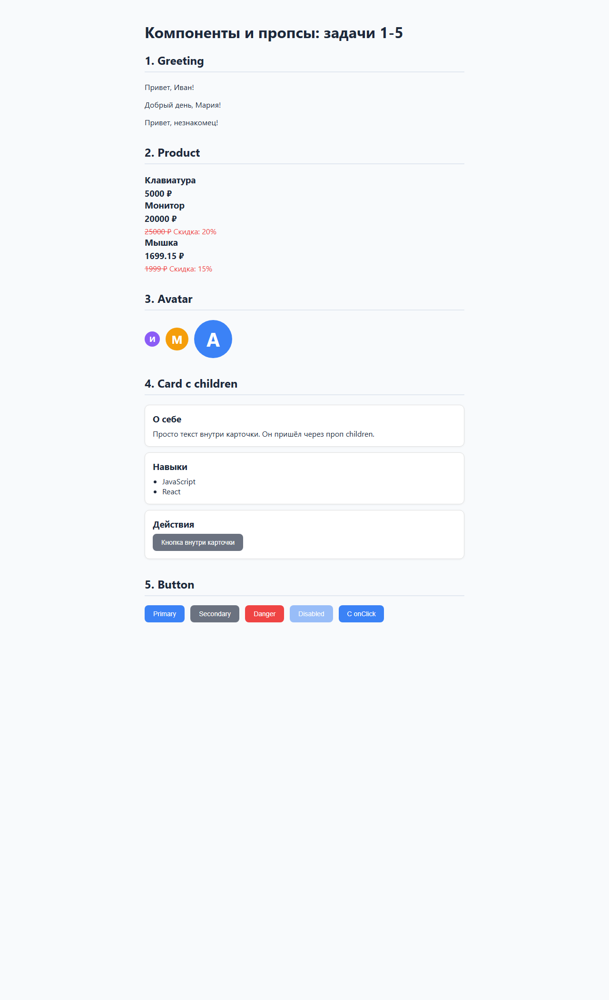
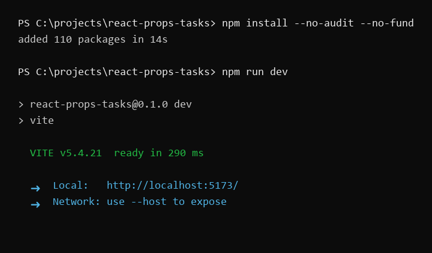
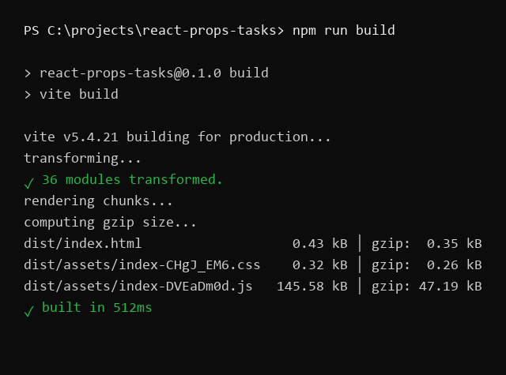

# react-props-tasks

Учебный проект на React. Пять задач на компоненты и пропсы из второй части курса.

## Стек

- React 18
- Vite 5
- Чистый CSS без библиотек

## Структура

```
src/
├── components/
│   ├── Greeting.jsx   Задача 1
│   ├── Product.jsx    Задача 2
│   ├── Avatar.jsx     Задача 3
│   ├── Card.jsx       Задача 4
│   └── Button.jsx     Задача 5
├── App.jsx            Демо всех компонентов
├── main.jsx           Точка входа
└── index.css          Глобальные стили
```

## Запуск

```bash
npm install
npm run dev
```

Сборка для проверки: `npm run build`.

## Компоненты

### Greeting

Принимает `name` и `greeting`. Дефолты: `"Привет"` и `"незнакомец"`. Вывод: `Привет, Иван!`.

```jsx
function Greeting({ name = 'незнакомец', greeting = 'Привет' }) {
  return (
    <p>
      {greeting}, {name}!
    </p>
  );
}
```

### Product

Принимает `title`, `price`, `discount`. Считает цену после скидки внутри компонента. Если скидка больше нуля, показывает зачёркнутую старую цену в `<s>` и процент скидки.

```jsx
const finalPrice = Math.round(price * (100 - discount)) / 100;

{discount > 0 && (
  <p>
    <s>{price} ₽</s> Скидка: {discount}%
  </p>
)}
```

### Avatar

Принимает `name` и `size`. Рисует круглый блок с первой буквой имени. Цвет берётся из палитры по коду первой буквы, поэтому одно имя всегда даёт один цвет.

```jsx
const color = PALETTE[name.charCodeAt(0) % PALETTE.length];
```

### Card

Принимает `title` и `children`. Рисует рамку и заголовок `<h3>`, внутри рендерит `{children}`. Дети могут быть любыми: текст, список, другой компонент.

### Button

Принимает `children`, `variant`, `onClick`, `disabled`. Варианты фона заданы словарём:

```jsx
const COLORS = {
  primary: '#3b82f6',
  secondary: '#6b7280',
  danger: '#ef4444',
};
```

У отключённой кнопки `opacity: 0.5` и `cursor: not-allowed`.

## Скриншоты

### Приложение



### Терминал




